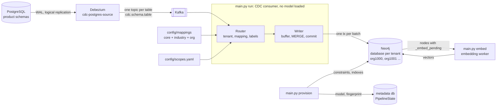
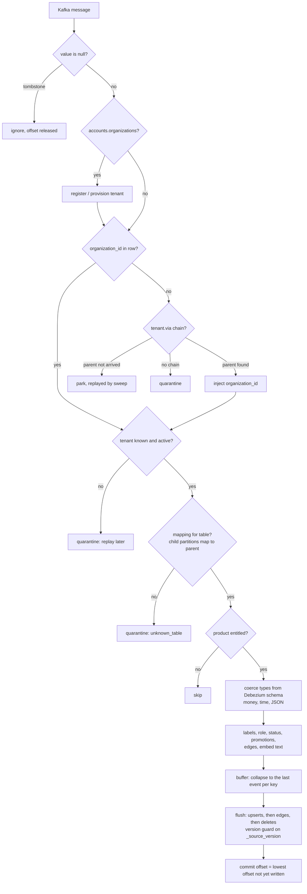
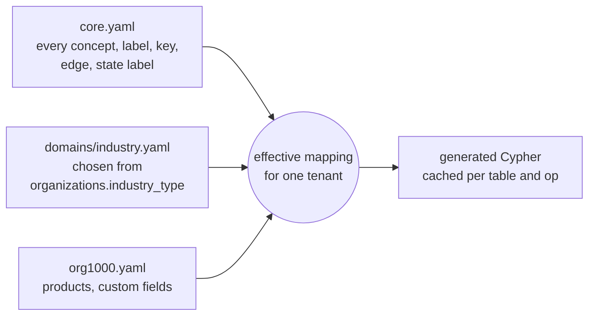
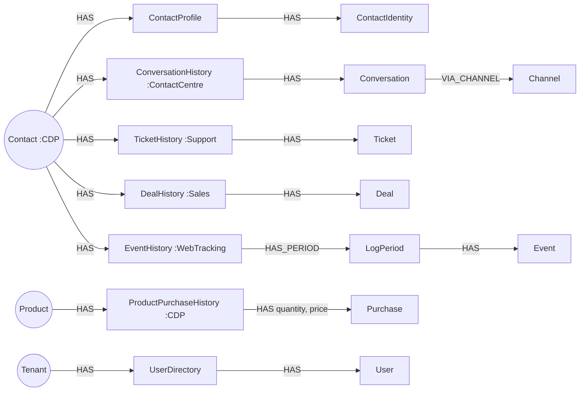
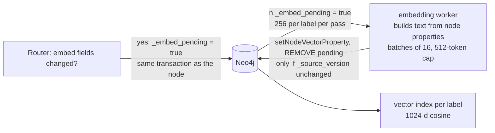

# Change Data Capture - Postgres to Neo4j


This pipeline turns your **PostgreSQL product databases** into one **Neo4j knowledge graph per tenant**, in real time. Every row change is streamed, mapped by declarative YAML, and written as a graph with simple English labels and explicit relationships.

This enables precise questions across products (tickets, deals, conversations, campaigns, and web activity), where an agent must follow **exact connections** such as who a ticket is assigned to or which deals belong to a contact, **alongside embeddings for semantic search**. There is **no table-specific code**: everything the pipeline writes is declared in YAML.

**Installing and running:** see [`SETUP.md`](SETUP.md).

## At a glance

| | |
|---|---|
| **Source** | PostgreSQL product schemas, streamed through Debezium and Kafka |
| **Target** | One Neo4j database per tenant (`org1000`, `org1001`, ...) |
| **Declared in YAML** | Core ontology, industry packs, and per-organisation overlays. No table-specific code. |
| **Safe by design** | Offsets are committed only after Neo4j accepts the write. Every event is written, parked, skipped, or quarantined. |
| **Searchable** | Embeddings (`bge-large-en-v1.5`, 1024-d) are produced by a separate worker, so the consumer never stalls. |
| **Multi-product** | Product labels (`Support`, `Sales`, `Marketing`, `ContactCentre`, `CDP`, `WebTracking`) control what each agent can read. |

### Quick start

```bash
python main.py validate                 # check mappings and ontology rules
./run_pipeline.sh --from-now            # start the CDC consumer
python main.py backfill --all           # load current data from PostgreSQL
python main.py integrity                # every line should be 0
./run_embedder.sh --mark-missing        # start the embedding worker
```

For a new environment, first run `bash scripts/register_connector.sh` and `python main.py preflight`. The full procedure is in [section 8](#first-start-or-rebuilding-after-an-ontology-change), and installation is in [`SETUP.md`](SETUP.md).

## Contents

1. [The whole system](#1-the-whole-system)
2. [One event, start to finish](#2-one-event-start-to-finish)
3. [Three layers: core + industry + organisation](#3-three-layers-core--industry--organisation)
4. [Graph model rules](#4-graph-model-rules)
5. [What a node looks like](#5-what-a-node-looks-like-product-labels-and-collections)
6. [Embeddings](#6-embeddings)
7. [Configuration](#7-configuration)
8. [Operations](#8-operations)
9. [Lessons and precautions](#9-lessons-and-precautions)
10. [Repository layout](#10-repository-layout)
11. [Contributing rules](#11-contributing-rules)

---

## 1. The whole system



| Component | What it does |
|---|---|
| **Debezium** | Streams every row change. Tables are snapshotted first, then changes are streamed live. |
| **Kafka** | Holds the change events. Order is kept within a partition. |
| `main.py run` | Routes each event to its tenant database, applies the ontology, and writes idempotent Cypher. It commits Kafka offsets only after Neo4j has accepted the write. |
| `main.py embed` | A separate process. It turns queued nodes into vectors (`bge-large-en-v1.5`, 1024 dimensions). |
| `main.py provision` | Creates the tenant database, constraints, hubs and vector indexes. Pipeline bookkeeping (schema fingerprint, embedding model) goes to the metadata database, never into the tenant graph. |

---

## 2. One event, start to finish



Nothing is ever lost silently. Every event ends in one of four places:

- **written** to Neo4j
- **parked** until its parent row arrives
- **skipped**, for a stated reason
- **quarantined** to `quarantine/*.jsonl`, with the reason recorded, and replayable

---

## 3. Three layers: core + industry + organisation



| Layer | File | Role |
|---|---|---|
| Core | `config/mappings/core.yaml` | The **only** place a concept is defined. |
| Industry | `config/mappings/domains/*.yaml` | Industry packs: bfsi, ecommerce, education, healthcare, legal, real-estate, saas. |
| Organisation | `config/mappings/org<id>.yaml` | Products the tenant bought and tenant-only additions. It may only **add**. |

**How industry packs work**

- The pack is selected from `accounts.organizations.industry_type`. The value must match exactly or as a whole word.
- A pack may only **add** classification labels, each with a `when:` rule. Examples: `ClaimQuery`, `PrescriptionRequest`, `BugReport`, `CartEvent`.
- A pack may add values to a shared core label. For example, healthcare adds `insurance` to `BillingQuery`.
- A pack may add custom-field rules.

`python main.py validate` rejects:

- any synonym
- any unconditional industry label
- any reuse of a core label on another table
- any overlay that renames, re-keys, or removes a core construct

---

## 4. Graph model rules

1. **One simple English name per concept, in every industry.**
   - A person is a `Contact` in a hospital, a school, and a bank. `Patient`, `Learner`, and `Shopper` are not labels.
   - Industry wording belongs in the UI and in values, never in labels.

2. **Role and state are labels, and exactly the right ones at a time.** On every upsert, the table's state labels are removed and the ones that match the current row are set again.

   | Node | One-of labels |
   |---|---|
   | `Contact` | `Lead`, `Prospect`, `Customer` (from `contact_type`) |
   | `Ticket` | `OpenTicket`, `InProgressTicket` (stored `Pending`), `ReopenedTicket`, `OverdueTicket`, `ResolvedTicket`, plus `UrgentTicket` and the topic labels `BillingQuery`, `Complaint`, `DocumentRequest`, `AccessRequest` |
   | `Conversation` | `ChatConversation`, `EmailConversation`, `WhatsAppConversation`, `InstagramConversation`, `FacebookConversation`, `VoiceConversation`, `BotHandled`, `StaffHandled` |
   | `Deal` | `OpenDeal`, `WonDeal`, `LostDeal`, `CommitDeal`, `BestCaseDeal` |
   | `Contract` | `ActiveContract`, `EndedContract`, `AutoRenewContract`, `MonthlyContract`, `QuarterlyContract`, `AnnualContract` |
   | `Invoice` | `UnpaidInvoice`, `OverdueInvoice`, `PaidInvoice`, `EscalatedInvoice` |
   | `Meeting` | `ScheduledMeeting`, `CompletedMeeting`, `MissedMeeting`, `CancelledMeeting`, `OnlineMeeting` |
   | `Product` | `ActiveProduct`, `ArchivedProduct`, `RecurringProduct`, `OneTimeProduct`, `StockedProduct`, `SeatBasedProduct`, ... |

3. **Merge what is one thing, and keep it fine-grained with static labels.**
   - `Staff` merges `ContactCentreStaff` and `SupportStaff`.
   - `LineItem` merges `QuoteLine`, `OrderLine`, and `InvoiceLine`.
   - `ConnectedChannel` merges `EmailChannel`, `ChatChannel`, and `SocialChannel`.
   - `BotPolicy`, `SLA`, `DocumentTemplate`, `LeadJob`, `Notification`, and `InternalNote` work the same way.

4. **Dimensions are shared nodes; their values carry the industry.**
   - Products link to `ProductCategory`, which is part of a `ProductSubcategory` hierarchy, and to `Brand`.
   - Accounts link to `Industry`.
   - "Cardiology" and "Apartments" are values, not labels.

5. **Relationship types are UPPER_SNAKE_CASE verbs**, for example `RAISED_BY`, `ROUTED_TO`, `HAS_EMPLOYEE`, `IN_CATEGORY`.

6. **Order never loses an edge.**
   - When an edge points at something that has not arrived yet, the target is created as a *stub* with only its key (and `_stub_since`). Its own row fills it in later and removes the marker.
   - Field-matched edges (a ticket's SLA by priority) never create anything. Backfill runs tables in dependency order so their targets exist.
   - `main.py integrity` reports stubs that are never filled (wrong key type, missing table, deleted parent).

7. **Edges follow their columns.** When a foreign key changes or is cleared, the old edge is removed. A reassigned ticket keeps only its new assignee.

8. **One product label per product node, none on setup/catalog nodes:** `Support`, `Sales`, `Marketing`, `ContactCentre`, `CDP`, `WebTracking`. Tenant, User, Team, Channel, Product and the like carry none (see [section 5](#5-what-a-node-looks-like-product-labels-and-collections)).

9. **One-to-many goes through a collection; no supernodes.**
   - One collection per kind per owner, owned by the product of its items:
     `(:Contact)-[:HAS_DEAL_HISTORY]->(:DealHistory)-[:HAS_DEAL]->(:Deal)`
   - High-volume streams add month buckets:
     `(:EventHistory)-[:HAS_PERIOD]->(:LogPeriod)-[:HAS_EVENT]->(:Event)`
   - Messages connect only to their conversation:
     `(:Conversation)-[:HAS_MESSAGE]->(:Message)`
   - Conversations carry channel *labels* rather than an edge to one `Channel` node.

10. **Every MERGE is an index seek.** Every label that gets MERGEd has a uniqueness constraint, including collections (keyed by `uid`), `LogPeriod`, and dimensions.

11. **Embeddings carry meaning; labels carry state.**
    - `embed.fields` lists descriptive text only: subject, description, notes, and name.
    - Status and priority are labels. They are never embedded.

12. **Excluded tables.**
    - `campaign.branches` and `accounts.setup_channel_configs` are not maintained by the apps, so they use `emit_to_graph: false`.
    - The CCaaS tables use their own `channel` column instead of joining through `channel_config`.

The full label catalog is in [`docs/ONTOLOGY_RULES.md`](docs/ONTOLOGY_RULES.md).

---

## 5. What a node looks like, product labels and collections

A tenant graph contains business records and nothing else: no schema catalog, no hub nodes. About 80 configuration, log, and high-volume tables are deliberately left out (`config/archive/dropped_from_graph_v45.yaml`).

**A node** holds its business properties plus:

| Property | Meaning |
|---|---|
| `organization_id` | Tenant id |
| `_source_version` | Version guard against stale overwrites |
| `_embedding` | Vector (embedded labels only) |
| `_embed_pending` | Set while the node is queued for embedding |
| `_stub_since` | Only on a stub, until its row arrives |

### Product labels

A node written from a product's tables carries exactly one product label. Setup and catalog nodes carry none.

| Schema | Product label | Examples |
|---|---|---|
| ticketing | `Support` | Ticket, SupportAgent, SupportQueue, SupportSLA, Note |
| crm | `Sales` | Account, Deal, Quote, Invoice, SalesRep |
| campaign | `Marketing` | Campaign, Delivery, MarketingAgent, Unsubscribe |
| ccass | `ContactCentre` | Conversation, ContactCentreAgent, ContactCentreQueue, ContactCentreSLA |
| cdp | `CDP` | Contact, ContactIdentity, Purchase, Segment, Persona, Insight, NextBestAction |
| digital (+ web events and sessions collected in cdp) | `WebTracking` | Website, Session, Event |
| accounts, inventory | *(none)* | Tenant, User, Team, Role, BusinessHours, Channel, PhoneNumber, KnowledgeDocument, Product |

**Reading rule for agents:** a node is readable when it has no product label, or one of the agent's products. Every node on a path is checked, so a Support agent can step onto a `User` but not onto that user's `MarketingAgent`. This is enforced in the read path (`src.scope.scoped_read`, the agent endpoints); no database grants are needed.

The same label may exist in several products when it means the same kind of thing (`Session` = `Marketing:Session`, `Support:Session`, `CDP:Session`). Keys then carry a product prefix.

### People

One `User` per person, acting in each product through a role node, so product activity stays separate:

```text
(User) -ACTS_AS-> (ContactCentreAgent :ContactCentre) <-HANDLED_BY- (Conversation)
       -ACTS_AS-> (SupportAgent :Support)             <-ASSIGNED_TO- (Ticket)
       -ACTS_AS-> (SalesRep :Sales)                   <-OWNED_BY-    (Deal)
       -ACTS_AS-> (MarketingAgent :Marketing)         <-CREATED_BY-  (Campaign)
```

### Relationships

- `HAS` for containment (owner → collection → item, parent → its parts).
- A verb for business meaning: `ASSIGNED_TO`, `RESOLVED_BY`, `HANDLED_BY`, `ROUTED_TO`, `VIA_CHANNEL`, `MEMBER_OF`, `ACTS_AS`, `IN_SEGMENT`.
- The validator allows one `HAS` between any two labels.

### Collections

Collections exist only on anchors:



| Anchor | Collections |
|---|---|
| **Contact** | ContactProfile, ConversationHistory, TicketHistory, DealHistory, OrderHistory, ActivityHistory, PurchaseHistory, CampaignHistory, DeliveryHistory, EventHistory, SessionHistory, InsightHistory, NextBestActionHistory. Small one-to-few items (sales profile, journey states, lead summaries, email engagement) hang directly off the contact. A conversation carries its own `summary`. |
| **Tenant** | UserDirectory, TeamDirectory, ChannelDirectory, KnowledgeLibrary, ProductCatalog, MacroLibrary |
| **Product** | ProductPurchaseHistory (order lines on the edge) |
| **Account (B2B)** | AccountDealHistory, AccountOrderHistory, AccountInvoiceHistory, AccountContractHistory |
| **Ticket** | TicketAuditTrail, ProactiveHistory. Deliveries point to their campaign directly (`FOR_CAMPAIGN`). |

### Enforced and checked

- `main.py validate`: config rules
- `main.py integrity`: live graph
- `scripts/reasoning_check.py`: 38 product questions as paths ([`docs/ONTOLOGY_REASONING.md`](docs/ONTOLOGY_REASONING.md))
- `main.py verify`: the same questions on real data

### Deletes

Deleting a row deletes its node, its edges, and any collection it leaves empty. Deleting a contact removes its collections (the items stay). `main.py reconcile-deletes` (run by backfill at the end) removes anything a missed delete left behind.

---

## 6. Embeddings



- **Model:** `BAAI/bge-large-en-v1.5`, 1024 dimensions, 512 tokens maximum.
  - Search queries get the prefix `Represent this sentence for searching relevant passages: `.
  - Stored records get no prefix.
  - Use `EmbeddingService.encode_query()` on the query side.
- **Text format:** `"Ticket. subject: Login fails. description: Portal loops back to sign-in."`
- **Crash-safe:** the queue lives in Neo4j, so nothing held in memory can be lost.
- **Off the CDC path:** nodes appear immediately, and their vectors follow.
- **Latency on a 4-core i3-10100 (estimate):** about 55 ms per short record, 0.35 s per ticket, and 1 s per 512-token article. A single query takes 40–60 ms. Measure your own machine with `scripts/bench_embeddings.py`.
- **Model record:** the model behind the vectors is stored once per database (`PipelineState` in the metadata database), not on each node. A worker refuses a database recorded with another model.
- **Switching models** (e.g. to Qwen): run `embed --switch-model`. A second worker with the new model fills `_embedding_next` while search keeps using the old vectors. Then `embed --switch-finish` swaps them in. Step by step in [`SETUP.md`](SETUP.md), section 7.

---

## 7. Configuration

`.env` holds the secrets and never goes into git. `.env.example` is the template.

| Variable | Purpose |
|---|---|
| `PG_HOST` `PG_PORT` `PG_DATABASE` `PG_USER` `PG_PASSWORD` | PostgreSQL, as the consumer reaches it |
| `DEBEZIUM_PG_HOST` `DEBEZIUM_PG_PORT` | PostgreSQL, as the Debezium container reaches it |
| `KAFKA_BOOTSTRAP` `CONNECT_URL` | Kafka and Kafka Connect |
| `NEO4J_URI` `NEO4J_USER` `NEO4J_PASSWORD` | Neo4j Enterprise, which is required for a database per tenant |
| `EMBEDDING_MODEL` `EMBEDDING_THREADS` ... | Optional overrides of `embedding:` |
| `MEILI_URL` `MEILI_KEY` | Meilisearch, for the ontology search scripts |

`config/connections.yaml` has these sections:

| Section | Contents |
|---|---|
| `postgres` | Connection details, read from the environment |
| `kafka` | `group_id` (change it to replay from the start). `topic_prefix` must equal the Debezium `topic.prefix`. |
| `neo4j` | Instance map |
| `database_naming.prefix` | `org`. Immutable once set. |
| `control_plane` | The tenant table and its columns, including `industry_column` |
| `batching`, `retry` | Write batching and deadlock retries |
| `embedding` | Model, dimensions, token cap, batch size, and threads |

---

## 8. Operations

| Command | Use |
|---|---|
| `python main.py validate` | Check every mapping and ontology rule. Run it before every commit. |
| `python main.py dry-run --org org1000` | Print the generated Cypher per table |
| `python main.py preflight` | Check PostgreSQL: `REPLICA IDENTITY FULL`, publication, and slot |
| `python main.py provision --all` | Create the databases, constraints, and vector indexes |
| `./run_pipeline.sh` (`main.py run`) | CDC consumer, single-threaded. `--from-now` skips the Kafka backlog on a fresh start. |
| `./run_embedder.sh` (`main.py embed`) | Embedding worker. Add `--mark-missing` once after a model change or a rebuild. |
| `python main.py embed --status` | Embedding backlog per label |
| `python main.py backfill --all` / `--org 1000` | Load everything from PostgreSQL (dependency order, then delete-reconcile) |
| `python main.py reset --all` / `--org 1000` | Remove every graph the pipeline wrote (confirm with `DROP` or `--yes`) |
| `python main.py integrity` | Check the live graph against the rules. All zeros = healthy. |
| `python main.py verify --database org1000` | Read-only report on real data: product questions and id-space checks |
| `python main.py replay-quarantine --date YYYY-MM-DD` | Retry quarantined events |
| `python scripts/diagnose_pipeline.py` | Check Debezium state, consumer group members, Kafka lag and retention, node counts, and vector sizes |
| `python scripts/reconcile.py --org 1000` | Compare PostgreSQL row counts with Neo4j label counts |
| `python scripts/reset_graph.py [--kafka-only \| --graph-only]` | Wipe the tenant graphs and/or rewind the consumer group to the earliest offsets (pure Python, no Kafka CLI needed) |
| `python scripts/bench_embeddings.py` | Embedding latency and RAM on this machine |
| `python scripts/build_column_catalog.py` | Refresh the column meanings from `database_schemas/` |
| `bash scripts/register_connector.sh` | Create or update the Debezium connector |

### First start, or rebuilding after an ontology change

1. Run `scripts/register_connector.sh` and `main.py preflight` (new environment only).
2. Run `main.py validate`.
3. Stop the pipeline and embedder; run `main.py reset --all` (skip on a brand-new environment).
4. Start `./run_pipeline.sh --from-now`.
5. Run `main.py backfill --all`.
6. Run `main.py integrity`: every line should be `0`.
7. Start `./run_embedder.sh --mark-missing`.

> Nothing old is replayed from Kafka. Current data comes from Postgres, and live changes made during the backfill still win because every backfilled row carries the database time of its read.

### Troubleshooting

| Symptom | Check |
|---|---|
| Consumer says it has had no messages yet | Run `diagnose_pipeline.py`. Either every partition is caught up (nothing new), or another member of the same group holds the partitions. |
| Connector rejected with `$` in its config | Connect does not expand `${VAR}`. Use `register_connector.sh`, which substitutes values from `.env`. |
| Connector task `FAILED` with a PostgreSQL connection error | `DEBEZIUM_PG_HOST` must be reachable from inside the Connect container. |
| `UNKNOWN_TOPIC_OR_PART` in Connect | `KAFKA_ADVERTISED_LISTENERS` must advertise an address that Connect can reach. |
| Deletes quarantined as `missing_tenant_id` | Set `REPLICA IDENTITY FULL` on the table. `preflight` reports it. |
| Vectors missing | Run `main.py embed --status`, then check that the worker is running. |

---

## 9. Lessons and precautions

<details>
<summary><b>Click to expand the full table</b></summary>

<br>

| Topic | What happened | What the pipeline does now |
|---|---|---|
| Exclusive labels | `SET` never removes labels, so tickets kept `OpenTicket` and `ResolvedTicket` at the same time | Each upsert removes the table's state labels, then sets the ones that match |
| Channel config | `channel_config` joins were unreliable | CCaaS tables use their own `channel` column. `setup_channel_configs` is excluded. |
| Phantom nodes | An edge to a missing parent created an empty node | Only declared stubs can be created. Entity targets are matched, and the edge is skipped if the target is missing. |
| Out-of-order snapshot | Rows arrived before the rows they point at | Targets are created as stubs and filled in later; backfill runs in dependency order; `main.py integrity` reports stubs never filled |
| Stale overwrites | An older event overwrote a newer one | Version guard on `_source_version` |
| Partitions | Debezium emits child partitions (`_2026_09`) | `ByLogicalTableRouter` plus `resolve_table()` map them to the parent via `pg_inherits` |
| Missing topics | Empty tables had no topic, which caused `REQTMOUT` spam | `_ensure_topics()` creates them at boot |
| `lookup_source` / `view` | The builder crashed on read-only modes | Those modes generate no Cypher |
| Tenant column | Code assumed `tenant_id` | The tenant column is `organization_id`. Child tables resolve through `tenant.via`, and the resolved id is added to the row. |
| Idle PostgreSQL connections | `connection is closed` errors | The resolver reconnects through `pg_factory` |
| Neo4j defunct connections | Log noise | Harmless. The driver retries. |
| Missing constraints | MERGE on collections and `LogPeriod` scanned whole labels, and got slower as the graph grew | Constraints exist for every label that is MERGEd |
| Silent config keys | `static` sublabels, `creates_hubs`, and `industry_type` were parsed but never used | All are implemented and covered by tests |
| Offsets | Auto-commit would lose buffered events | The offset committed is the lowest offset not yet written |
| Deletes | A before-image under `REPLICA IDENTITY DEFAULT` has no tenant | `preflight` requires `REPLICA IDENTITY FULL` |
| Money and time | `double` and millisecond precision lose data | `decimal.handling.mode: string` and `time.precision.mode: adaptive` |
| Embedding model | Loading a model inside the consumer stalled it | A separate worker process, with the queue in Neo4j |
| Schema name | Startup checked schema `ccaas`; the real schema is `ccass` | The schema list is derived from `core.yaml` |

</details>

---

## 10. Repository layout

```text
main.py                     CLI entry point
run_pipeline.sh             CDC consumer launcher (1 thread)
run_embedder.sh             embedding worker launcher (4 threads)
src/
  consumer.py               Kafka loop, control events, offset commits
  router.py                 event -> tenant -> mapping -> labels, edges, embed text
  writer.py                 collapsing buffer, ordered flush, offset watermark
  cypher_builder.py         Cypher generation (the only place Cypher is built)
  config_loader.py          core + industry + org merge
  validation.py             config and ontology rules
  provision.py              databases, constraints, indexes
  scope.py                  product labels, scoped reads
  graph_rules.py            config-time graph rules checked by `validate`
  integrity.py              live-graph checks (`main.py integrity`)
  reset.py                  drop tenant graphs (`main.py reset`)
  verify.py                 live-graph report (`main.py verify`)
  id_mapping.py             Campaign's contact-id projection of cdp_id
  graph_state.py            per-database bookkeeping in the metadata database
  embedder.py               embedding model service
  embedding_worker.py       durable embedding queue consumer
  model_switch.py           re-embed with a new model next to the old vectors
  reconcile.py              delete sweep for rows gone from Postgres
  tenant_resolver.py        organization_id through FK chains, parking
  coercion.py               Debezium types -> Neo4j types
  registry.py               tenants from accounts.organizations
  backfill.py quarantine.py dlq_consumer.py metrics.py drivers.py naming.py preflight.py
  ch_*.py                   ClickHouse sink (planned)
config/
  connections.yaml          infrastructure and embedding settings
  mappings/core.yaml        the ontology
  mappings/domains/*.yaml   industry packs
  mappings/org*.yaml        tenant overlays
  scopes.yaml               product label per domain, unscoped (setup/catalog) domains
  catalog/                  column meanings (generated from database_schemas/, not written to the graph)
  archive/                  retired configs, not loaded
database_schemas/           plain-language table and column docs
docker/                     compose files, Debezium connector, ontology tooling
scripts/                    operational tools (section 8)
ontology_steward/           classification of custom JSON fields
tests/                      pytest suite (tests/engine.py runs generated Cypher on an embedded engine)
docs/                       ONTOLOGY_RULES.md, UPGRADE_V4.md, RBAC, reference integrity, history/
```

---

## 11. Contributing rules

- **Before committing,** run `python main.py validate` and `python -m pytest`. Both must pass.
- **Comments:** use a short, plain explanation only when the code does not speak for itself.
  - No change logs in comments.
  - No commented-out code.
  - No banners.
  - Keep one-line docstrings.
  - History belongs in git; knowledge belongs in this README.
- **Labels:** PascalCase English. **Relationships:** UPPER_SNAKE_CASE verbs. One name per concept.
- **New concepts go into `core.yaml`.** Industry packs only classify.
- **Secrets only in `.env`.** Nothing in code or docs.
